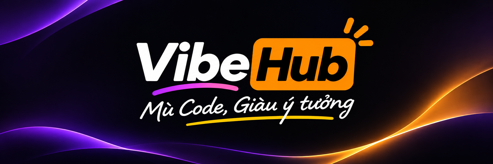

# Hi, I'm Linh

I can't code. Everything here was built by talking to AI: I come up with an idea, describe it in plain Vietnamese, let the AI write the code, then test it and ask for fixes until it works. People call this vibe coding. My own motto is on the banner: "Mù code, giàu ý tưởng", roughly "can't code, full of ideas".

I build games, tools, web apps and small apps for everyday life, and keep working on whatever people actually use.

## Interactive games for TikTok LIVE

Viewers comment, send gifts or tap hearts, and something happens on screen. A Vietnamese voice reads their names and thanks them for gifts.

| Project | What it is |
|---|---|
| [Cưới Liền Tay](https://github.com/workaipvlinh-byte/cuoi-lien-tay) | A 3D wedding party: propose with an @mention, steal the bride with gifts, a matchmaker god pairs couples, two comedy MCs host |
| [Đám Cưới Online](https://github.com/workaipvlinh-byte/dam-cuoi-online) | A countryside wedding: comment to take a seat, carry food trays, clink glasses, pose for photos with the couple |
| [Lớp Học Chữ](https://github.com/workaipvlinh-byte/lop-hoc-chu) | A teacher in an áo dài scrambles letters on the blackboard; the fastest correct guess gets the front desk |
| [Đi Chùa Online](https://github.com/workaipvlinh-byte/di-chua-online) | A 3D temple hall where viewers come in to offer incense, with falling flower petals |
| [Hồ Cá Live](https://github.com/workaipvlinh-byte/ho-ca-live) | Comment to release a fish; it grows the longer you watch, and gifts bring rarer fish |

## Tools, web apps, everyday apps

In progress. I'll add them here as they ship.

## How I build

I handle the ideas and the testing, and AI handles the code, mostly through Claude Code. Big jobs get split into small steps, and each step has to run before the next one starts. The code usually involves Node.js, TypeScript, React, Vite and Three.js. I don't need to know those well; the AI does.

If you can't code either but have ideas, feel free to look around, download something and run it, or message me to ask how I made it. A star on anything you like is appreciated.
